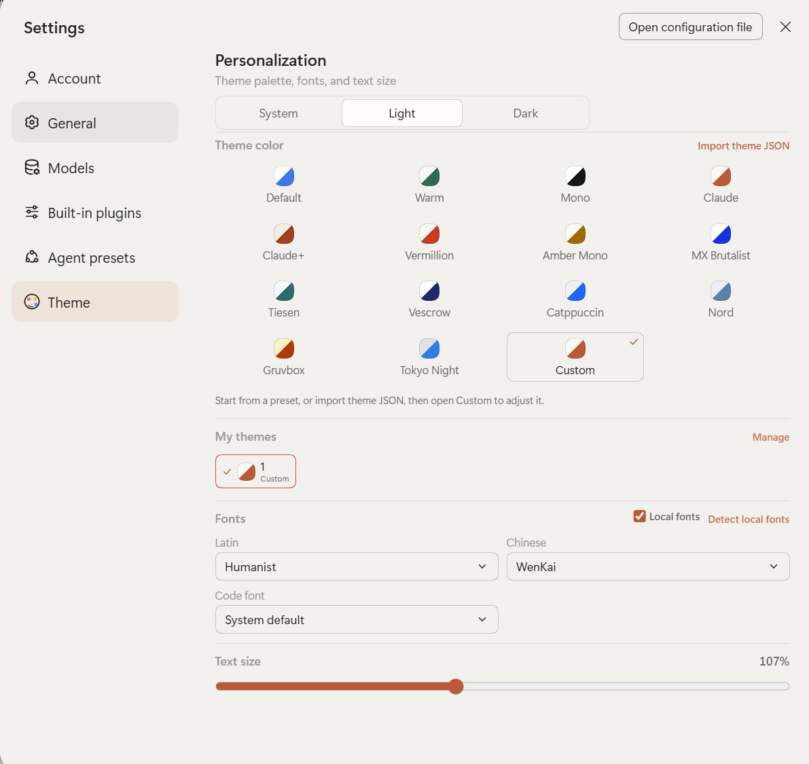

# DSH テーマ

[简体中文](README.zh.md) | [English](README.md) | **日本語** | [Español](README.es.md) | [Français](README.fr.md) | [Deutsch](README.de.md) | [Русский](README.ru.md) | [Português](README.pt.md)

[](https://github.com/SolvasHQ/dsh-theme/actions/workflows/verify.yml)
[](https://www.npmjs.com/package/@solvashq/dsh-theme)
[](https://dshopen.org/plugins/@solvashq/dsh-theme/)
[](https://awesome-dsh-plugin.com/p/SolvasHQ/dsh-theme/)

[DeepSeek Harness](https://github.com/deepseek-ai/deepseek-harness) Web GUI 用の
テーマ配色、本格的な DIY カラーエディター、名前付きカスタムテーマライブラリ、
ローカルフォント、文字サイズを提供します。サイドバー左下のパレットアイコンから
開けます。

ライトとダークの両方に対応し、各プリセット／DIY カラーは両モードの値を持ちます。
OS の外観がライト・ダーク・システムに変わってもそのまま機能します。

## スクリーンショット

ここでは英語 UI を掲載しています（中国語 README は中国語の画面）。他の非中国語
言語も同じレイアウトです。

| メインパネル | カスタムテーマエディター |
|:---:|:---:|
|  |  |

**設定 → テーマ**



**入口**：サイドバー**左下のパレットアイコン**（設定ボタンの 1 行上）。同じ画面は
**設定 → テーマ**からも開けます。

## 機能

- **14 種類のプリセット**：デフォルト、ウォーム、モノ、クロード、クロード+、
  バーミリオン、アンバーモノ、MX ブルータリスト、ティーセン、ヴェスクロウ、
  **Catppuccin、Nord、Gruvbox、Tokyo Night**、および「カスタム」。
- **DIY エディター**：ライト／ダークごとに背景、カード、ポップオーバー、サイドバー、
  テキスト、枠線、そのモードのアクセントを編集。状態色もモード別に保存し、
  「枠線を太く」スイッチも利用可能。未編集のスロットは自動派生します。
- **プリセットを正確に継承**：プリセットをベースにすると両モードの 14 アンカーを
  すべてコピーし、太枠などの特徴も引き継ぎます（例：MX ブルータリスト）。
- **名前付きカスタムテーマ**：「マイテーマ」で切り替え、現在のテーマに ✓ を表示。
  「管理」で複数選択して削除・エクスポートできます。
- **JSON インポート／エクスポート**：単体テーマまたはテーマパックを `.json` に
  書き出し、貼り付けまたはファイル選択で読み込み。コメント付きサンプルも用意。
  読み込んだテーマは JSON の `name` で「マイテーマ」に追加されます。
- **フォント**：英字・中国語・コード用を個別に選択。各メニューには内蔵プリセットと
  **このマシンから読み取ったフォント**（`ローカル ·`）が並び、表示のオン／オフ、
  再検出、プリセットとの重複が可能です。
- **文字サイズ**：10–22px。ネイティブのテーマサービスを使用し、再読み込み後も保持。
- **8 言語**：简体中文、English、日本語、Español、Français、Deutsch、Русский、
  Português (Brasil)。
- **再起動後も保持**：設定は DSH の Host 設定ドキュメントに保存されます。

## パレット一覧


## インストール

### Discover（推奨）

1. **Plugins → Discover** を開きます。
2. 次のインデックスを追加します。

   ```
   https://cdn.jsdelivr.net/gh/SolvasHQ/dsh-theme@be05cdd37d6123bea5ba50435217476d0c97f516/market/index.json
   ```

3. **DSH Theme** を開き、**Install** を押します。

インデックスは 1.5.0 の Git commit に固定されています。同じバージョンは npm
（`@solvashq/dsh-theme@1.5.0`）と GitHub Release の `dsh-theme.tgz` でも配布します。

### npm

```bash
npm install @solvashq/dsh-theme
```

DSH エージェントに `@solvashq/dsh-theme@1.5.0` を指定してインストールさせることも
できます。

### ソースから

```bash
git clone https://github.com/SolvasHQ/dsh-theme.git
cd dsh-theme
pnpm install --prod
```

このディレクトリを DSH プロファイルの bundle リストにリンクし（Plugin Manager で
絶対パスを指定するのがおすすめ）、プロファイル内で `pnpm install` を実行して DSH
を再起動します。

## 互換性

DeepSeek Harness デスクトップ `0.2.2-rc.1`（Web GUI）で検証済み。0.2.1-rc.2 系も
動作します。公開されているクライアント拡張点（`slots`、`theme`、`locale`、
`configForms`）と Host の volatile config のみを使用します。

## 配色クレジット

Catppuccin、Nord、Gruvbox、Tokyo Night は各作者によるコミュニティ配色です。色の
参照として DSH の 14 アンカーにマッピングし、コントラスト調整を加えています。URL は
`research/palettes.json` の `sources` に記載し、ライセンスは各プロジェクトに従います。

## ライセンス

MIT — [LICENSE](LICENSE) を参照。

[変更履歴](CHANGELOG.md) · [Issues](https://github.com/SolvasHQ/dsh-theme/issues)
