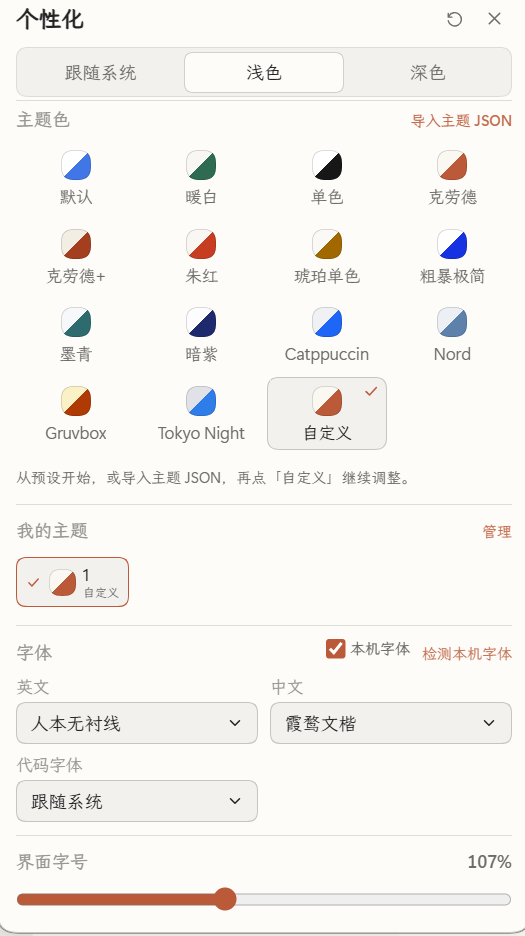
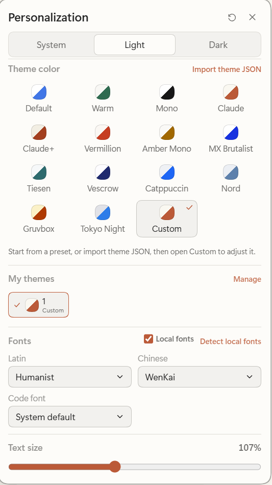
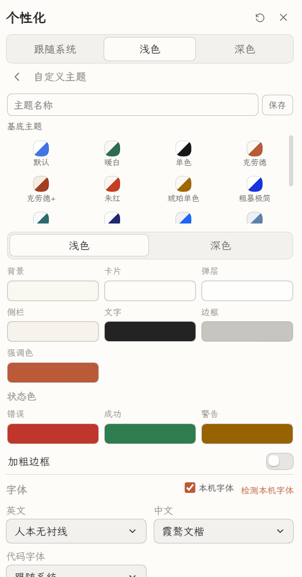
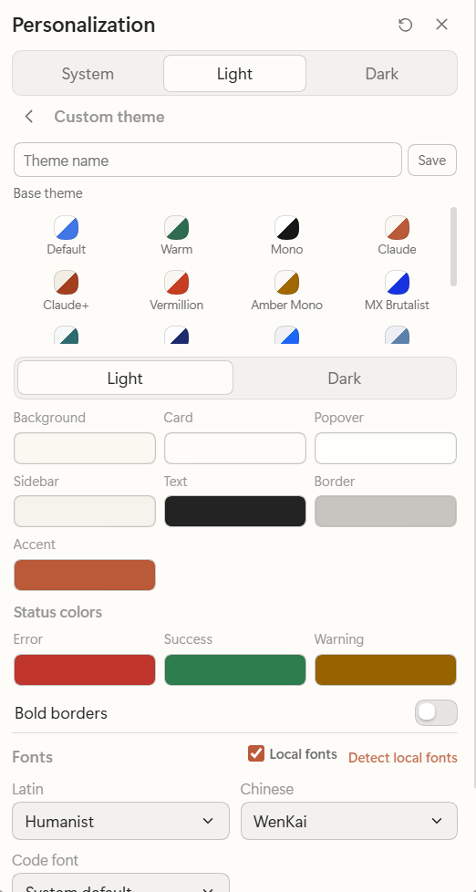
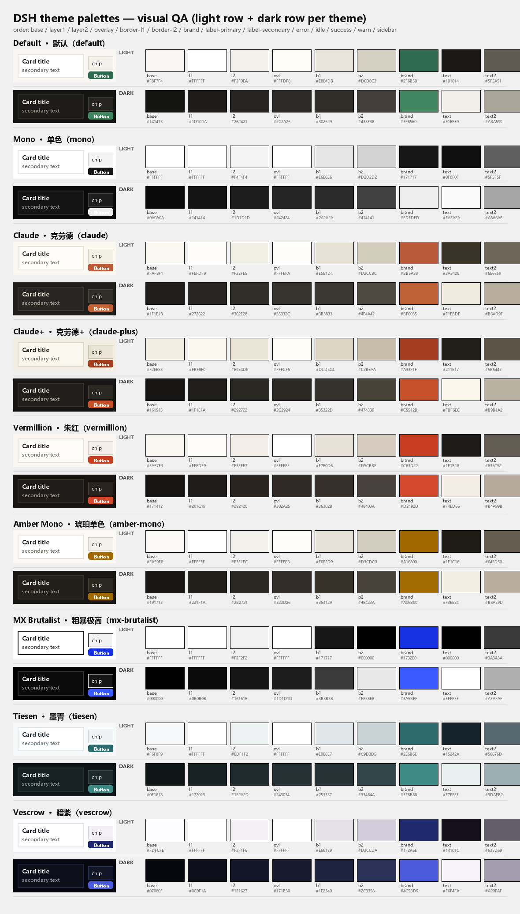

# DSH 主题

[English](README.md) | **简体中文**

[](https://github.com/SolvasHQ/dsh-theme/actions/workflows/verify.yml)
[](https://www.npmjs.com/package/@solvashq/dsh-theme)

为 [DeepSeek Harness](https://github.com/deepseek-ai/deepseek-harness) Web GUI 提供
主题配色、DIY 调色、字体与界面字号自定义，入口在侧边栏左下角的调色盘图标。

明暗双模：每套预设和每项 DIY 颜色都同时带浅色与深色两套值，因此原生外观在
浅色 / 深色 / 跟随系统之间切换时依然生效。

## 界面截图

| 中文界面 | 英文界面 |
|:---:|:---:|
|  |  |
|  |  |

**入口：侧边栏左下角的调色盘图标**——就是 Settings 按钮上方那一行图标。
点击即可在左下角弹出面板；同样的选项也在 **设置 → 个性化** 页面中。

界面文案跟随通用设置里的语言（简体中文 / English）。

## 功能

- **左下角入口**：侧边栏底部（Settings 按钮上方的图标行）新增调色盘图标，点击在
  左下角弹出紧凑面板。
- **设置页**：同样内容作为独立「个性化」页出现在 设置 中。
- **10 套主题配色**：默认（原生外观）、暖白、单色、克劳德、克劳德+、朱红、
  琥珀单色、粗暴极简、墨青、暗紫，另有「自定义」。
- **DIY 调色编辑器**：浅色/深色分开编辑——背景、卡片、弹层、侧栏、文字、边框，
  以及该模式自己的强调色；错误/成功/警告状态色共用；另有「加粗边框」开关
  （全局 1px 边框 + 墨色边框 token）。未手动指定的槽位会从背景/文字自动派生。
- **字体**：英文、中文、代码字体独立选择，作用于界面、对话与代码。
- **界面字号**：10–22px，走原生主题服务，重载后保留，并与 Ctrl/Cmd `+`/`-`
  快捷键同步。
- **中英双语**：跟随通用设置里的语言自动切换。
- **重启不丢失**：选择写入 DSH 的 Host 设置文档（volatile config），重启应用、
  更换本地端口后依然保留。

## 调色板参考

十套预设的浅色 / 深色配色对照：



## 安装

### Discover 一键安装（推荐）

不需要 npm 账号，也不需要手动改 profile：

1. 打开 **Plugins → Discover**。
2. 添加索引源：

   ```
   https://cdn.jsdelivr.net/gh/SolvasHQ/dsh-theme@v1.4.0/market/index.json
   ```

索引钉在 `@v1.4.0` 版本上，可立即使用；如果希望跟随最新提交，可把 tag 换成
`@main`——jsDelivr 对该分支可能有最长约 12 小时的缓存。

3. 找到 **DSH 主题**，打开详情页，点击 **Install**。

Discover 会安装该版本固定到 Git commit 的代码。同一版本也已发布到 npm
（`@solvashq/dsh-theme@1.4.0`），最新 GitHub Release 也附带预构建的
`dsh-theme.tgz`。jsDelivr
对 `@main` 分支可能有最长约 12 小时的缓存；想立即拿到新版本可访问
`https://purge.jsdelivr.net/gh/SolvasHQ/dsh-theme@main/market/index.json` 刷新缓存。

### npm

已发布为 [`@solvashq/dsh-theme`](https://www.npmjs.com/package/@solvashq/dsh-theme)：

```bash
npm install @solvashq/dsh-theme
```

也可以让 DSH Agent 直接从 npm 安装这个 bundle，spec 用
`@solvashq/dsh-theme@1.4.0`。

### 从源码安装（开发）

> 这是一个 **本地 DSH bundle**。安装方式是把克隆下来的目录链接进 DSH profile 的
> bundle 列表。运行需要 Node.js 20+ 与 pnpm。

1. 克隆仓库到固定位置：

   ```bash
   git clone https://github.com/SolvasHQ/dsh-theme.git
   cd dsh-theme
   ```

2. 在**插件目录内**安装运行时依赖。DSH 以保留符号链接的方式加载 profile 插件，
   因此 schema 库及其传递依赖必须位于插件自己的 `node_modules` 中：

   ```bash
   pnpm install --prod
   ```

3. 在 DSH profile 中注册该 bundle。推荐让 DSH 的 Agent 用 Plugin Manager 的
   bundle 安装方式安装这个目录（传绝对路径）。也可以手动编辑
   `<profile>/package.json`：

   ```json
   {
     "dsh": { "profile": { "bundles": ["@deepseek-ai/dsh-base", "@deepseek-ai/dsh-web-app", "@solvashq/dsh-theme"] } },
     "dependencies": { "@solvashq/dsh-theme": "link:/绝对路径/dsh-theme" }
   }
   ```

   然后在 profile 目录执行 `pnpm install` 并重启 DSH。

4. 打开 Web GUI：左下角出现调色盘图标；设置中也出现「个性化」页。

之后修改 `client.js` 会被 DSH 的客户端 HMR 在约一秒内热替换；修改 Host 侧代码
需要重启 DSH。

## 实现要点

- **主题覆盖层**：客户端用 `ctx.theme.overrideTokens('@solvashq/dsh-theme', tokens)`
  注册单一 token 覆盖层，每个 token 都是 `{ light, dark }` 对，因此叠加在原生
  配色之上，系统明暗切换无需重新注册主题。
- **token 生成**：每套配色/模式用 14 个锚点色生成约 97 个
  `--dsw-alias-*` / `--dsw-specific-*` 语义 token（表面、边框、文字、按钮、状态、
  Markdown/代码、diff、滚动条、toast、侧栏），并带对比度保护。
- **DIY 配色**：运行时从所选背景、边框、文字色与各模式强调色派生；改背景时未
  固定的槽位会自动跟随。
- **字体**：`--dsh-font-family-text` / `--dsh-font-family-code` 随 token 层下发，
  中英文字体栈自动拼接，未选的一侧回落到内置字体栈。
- **字号**：使用主题服务持久化的 `setFontSize('text', px)`。
- **持久化**：Host 半边在插件 entry 上声明一个 `.volatile()` 字符串字段，客户端
  通过 `ctx.configForms` 读写，DSH 会把它写入当前 profile 的 patch 并按浏览器
  身份持久化。明暗偏好与字号仍由原生主题设置管理。

## 开发

```bash
# 修改 src/client.template.js 或 research/palettes.json 后重新生成 client.js
node build/build-client.mjs
node --check client.js

# 静态检查（manifest、locale、图标、生成产物）
node tools/check-manifest.mjs

# 全量 token / 对比度检查（含 DIY 用例）
node tools/verify-tokens.mjs

# 面板组件功能测试（渲染 → 点击 → 断言，中英文）
node tools/check-panel.mjs
```

浏览器模块加载器不能 import 本地文件，因此
`build/build-client.mjs` 会把 `research/palettes.json` 内联进 `client.js`。
`client.js` 是提交进仓库的构建产物，CI 会重新构建并检查它是否最新。

## 目录结构

```
client.js                 浏览器端构建产物（提交）
index.js                  Host 半边：volatile 设置字段
cordis.patch.yml          bundle patch，插入插件行
locale/                   插件元数据（中/英）
src/client.template.js    客户端源码模板
build/build-client.mjs    构建脚本（palettes → client.js）
market/index.json         Discover 市场索引（format 1）
docs/screenshots/         README 截图（中文 / 英文界面）
research/                 配色锚点、设计说明、调色板图
tools/                    manifest、market、token、面板验证脚本
```

## 兼容性

在 DeepSeek Harness 桌面版 `0.2.1-rc.2`（Web GUI）上验证。插件只使用公开的
客户端扩展点（`slots`、`theme`、`locale`、`configForms`）与 Host volatile
config，不修改 Harness 本身、不读取其他插件的 DOM。

## 许可证

MIT，见 [LICENSE](LICENSE)。

[更新日志](CHANGELOG.md) · [问题反馈](https://github.com/SolvasHQ/dsh-theme/issues)
