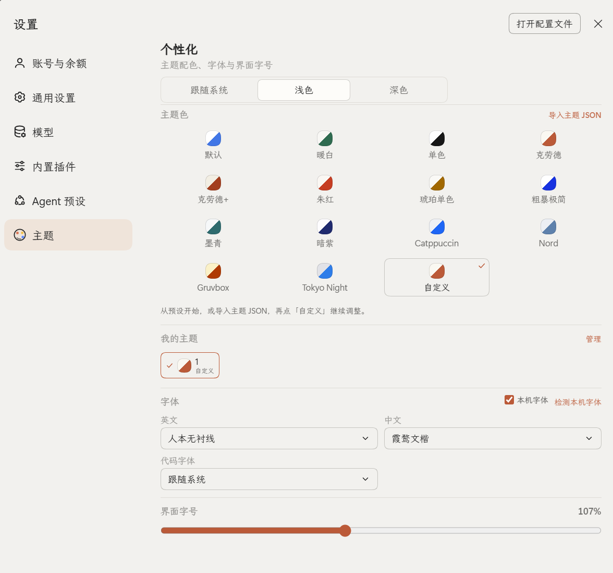

# DSH 主题

**简体中文** | [English](README.md) | [日本語](README.ja.md) | [Español](README.es.md) | [Français](README.fr.md) | [Deutsch](README.de.md) | [Русский](README.ru.md) | [Português](README.pt.md)

[](https://github.com/SolvasHQ/dsh-theme/actions/workflows/verify.yml)
[](https://www.npmjs.com/package/@solvashq/dsh-theme)
[](https://dshopen.org/plugins/@solvashq/dsh-theme/)
[](https://awesome-dsh-plugin.com/p/SolvasHQ/dsh-theme/)

为 [DeepSeek Harness](https://github.com/deepseek-ai/deepseek-harness) Web GUI 提供
主题配色、完整 DIY 调色、具名自定义主题库、本机字体与界面字号；入口在侧边栏左下角
的调色盘图标。

明暗双模：每套预设和每项 DIY 颜色都同时带浅色与深色两套值，因此原生外观在
浅色 / 深色 / 跟随系统之间切换时依然生效。

## 界面截图

这里使用中文界面；其他七种语言共用同一布局，使用英文截图。

| 中文主面板 | 中文自定义主题编辑器 |
|:---:|:---:|
|  |  |

**设置 → 主题**



**入口**：侧边栏**左下角的调色盘图标**，就在 Settings 按钮上方那一行图标里。
同样的页面也在 **设置 → 主题** 中。

## 功能

- **左下角入口**：侧边栏底部新增调色盘图标，点击弹出紧凑面板；设置中也有独立的「主题」页。
- **14 套主题配色**：默认、暖白、单色、克劳德、克劳德+、朱红、琥珀单色、粗暴极简、
  墨青、暗紫，以及 **Catppuccin、Nord、Gruvbox、Tokyo Night**，另有「自定义」。
- **完整 DIY 编辑器**：浅色/深色分开编辑背景、卡片、弹层、侧栏、文字、边框与该模式
  强调色；状态色按模式保存；可开启「加粗边框」。未编辑的槽位自动派生。
- **完整预设基底**：从预设开始时复制两套模式各自的全部 14 个锚点，并继承预设特征
  （例如 **粗暴极简** 会自动开启加粗边框）。
- **具名自定义主题**：给主题命名保存，在「我的主题」中切换并显示 ✓；进入「管理」可
  多选删除或导出。
- **JSON 导入/导出**：支持单个主题或主题包；可粘贴 JSON 或选择文件，弹窗内提供带
  注释的示例。导入的主题会出现在「我的主题」，名称取 JSON 的 `name`。
- **字体**：英文、中文、代码字体独立选择；每个菜单含内置方案与**本机字体**
  （标记 `本机 ·`），可隐藏本机字体、手动检测，允许与预设重名。
- **界面字号**：10–22px，走原生主题服务，重载后保留。
- **八种语言**：跟随应用语言：简体中文、English、日本語、Español、Français、
  Deutsch、Русский、Português (Brasil)。
- **重启不丢失**：选择写入 DSH 的 Host 设置文档。

## 调色板参考


## 安装

### Discover（推荐）

1. 打开 **Plugins → Discover**。
2. 添加索引源：

   ```
   https://cdn.jsdelivr.net/gh/SolvasHQ/dsh-theme@v1.5.0/market/index.json
   ```

3. 找到 **DSH 主题**，点击 **Install**。

该索引固定到 1.5.0 的 Git commit。同一版本发布在 npm
（`@solvashq/dsh-theme@1.5.0`），GitHub Release 也附带 `dsh-theme.tgz`。

### npm

```bash
npm install @solvashq/dsh-theme
```

或让 DSH Agent 安装 `@solvashq/dsh-theme@1.5.0`。

### 从源码安装

```bash
git clone https://github.com/SolvasHQ/dsh-theme.git
cd dsh-theme
pnpm install --prod
```

然后把该目录链接进 DSH profile 的 bundle 列表（推荐让 DSH Agent 用插件管理器
安装这个绝对路径），在 profile 内执行 `pnpm install` 并重启 DSH。

## 兼容性

在 DeepSeek Harness 桌面版 `0.2.2-rc.1`（Web GUI）上验证；0.2.1-rc.2 也仍然
可用。插件只使用公开的客户端扩展点（`slots`、`theme`、`locale`、
`configForms`）与 Host volatile config。

## 配色致谢

Catppuccin、Nord、Gruvbox、Tokyo Night 是各自作者维护的社区配色。本项目把它们
作为颜色参考，映射到 DSH 的 14 个锚点并做了对比度调整；链接记录在
`research/palettes.json` 的 `sources` 中，许可证以各自仓库为准。

## 许可证

MIT，见 [LICENSE](LICENSE)。

[更新日志](CHANGELOG.md) · [问题反馈](https://github.com/SolvasHQ/dsh-theme/issues)
